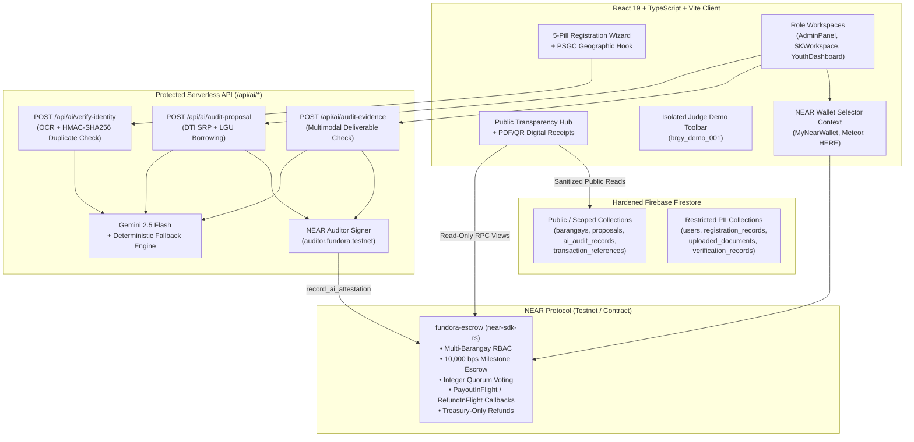

# Fundora — AI-Audited Civic Treasury & Programmable Escrow on NEAR

**Target:** NEAR Hackathon 2026 (Submission Deadline: November 14, 2026)  
**Repository:** `https://github.com/zneright/Fundora`  
**Smart Contract (`near-sdk-rs`):** [`contracts/fundora-escrow`](file:///C:/Users/Renz%20Jericho%20Buday/Fundora/contracts/fundora-escrow/src/lib.rs) (`389,772 bytes`, SHA-256: `a25d34cd0eec0ea8494a9680bd453cbe748d7f8cfd3ac34e3099a754fce9976b`)

---

## 1. Overview: Problem & Solution

### The Problem
Local youth councils (**Sangguniang Kabataan / SK**, governed by Philippine Republic Act No. 10742) and **Barangays** manage billions of pesos in grassroots community budgets (`10%` SK Fund allocation). However, local civic project execution suffers from three persistent structural gaps:
1. **Opaque Lump-Sum Disbursements:** Project budgets are released without milestone-locked escrow or resident quorum verification before subsequent tranches are paid out.
2. **Manual, Unbenchmarked Procurement:** Bill-of-Quantities (BOQ) line items are rarely cross-checked against Department of Trade and Industry (**DTI**) Suggested Retail Prices (**SRP**) or existing City/Municipal LGU equipment pools before funds are committed.
3. **Fragmented Public Accountability:** Citizens lack a single, privacy-preserving portal that separates immutable on-chain financial state from supporting project metadata and downloadable transaction-linked receipts.

### The Fundora Solution
**Fundora** is a clean-room, NEAR-native civic treasury and milestone-based programmable escrow platform paired with a protected server-side AI procurement and deliverable auditor:

1. **Authoritative NEAR Rust Smart Contract (`fundora-escrow`):**
   - Multi-barangay namespace isolation (`brgy_<10-digit-PSGC>`) with strict role-based access control (`system_admin`, `barangay_admin`, `sk_official`, `verified_resident`) defaulting to `false` for all unassigned accounts.
   - Configurable `2..=5` milestone splits summing to `10,000 bps` (`100.00%`), supporting both **`40% / 40% / 20%`** and **`40% / 30% / 30%`** civic infrastructure schedules with optional Phase 1 upfront mobilization (`immediate_phase_1: true`).
   - Integer basis-point resident quorum voting (`(votes_approve * 10000) >= (total_votes * quorum_bps)` once `total_votes >= min_votes`, with `min_votes >= 3` enforced for all production barangays) and conflict-of-interest self-voting prevention.
   - Asynchronous cross-shard transfer safety (`PayoutInFlight`, `RefundInFlight`) with private callbacks (`on_transfer_complete`, `on_refund_complete`) and `ReconciliationRequired` recovery (`retry_failed_milestone_payout`, `retry_failed_refund`).
   - **Treasury-Only Refund Invariant:** Rejected or disputed project balances return strictly to `project.funder_treasury` (the Barangay Admin treasury account that funded the escrow)—never to `sk_official`.

2. **Protected Server-Side AI Civic Auditor (`Gemini 2.5 Flash` + `fundora-auditor-bestdish.testnet`):**
   - Executes strictly on the backend (`/api/ai/verify-identity`, `/api/ai/audit-proposal`, `/api/ai/audit-evidence`) so `GEMINI_API_KEY` and `NEAR_AUDITOR_PRIVATE_KEY` are never exposed to the browser.
   - Benchmarks proposal line items against DTI SRP reference prices, flags potential overpricing, and recommends **inter-agency LGU equipment borrowing** (e.g., borrowing tents, sound systems, or heavy equipment from the City/Municipal Engineering Office or CDRRMO at ₱0 rental cost).
   - Evaluates multimodal milestone evidence photos and official receipts, computes a canonical SHA-256 report digest, and records an on-chain attestation via `record_ai_attestation`.
   - **Strict Advisory-Only Trust Boundary:** AI scores and attestations never auto-approve KYC, never auto-create escrows, and never auto-release or refund funds. Human Barangay Admins and Verified Resident Quorums retain 100% financial and governance authority.

3. **Guided 5-Step Registration, PSGC Geographic Engine & Statutory Age Routing:**
   - Preserves the complete 5-pill onboarding flow (`Account & Email` $\rightarrow$ `Role & LGU` $\rightarrow$ `Personal Identity` $\rightarrow$ `Residency & Term` $\rightarrow$ `Document Vault`), live PSGC geographic cascading (`psgc.cloud` / PSA API) with NCR special-case handling and a bundled `3-second` offline static fallback (`psgcFallback.json`).
   - Enforces **R.A. 10742 (as amended by R.A. 11768)** age-bracket routing:
     - **Katipunan ng Kabataan (KK) Youth Voters:** Ages 15–30.
     - **Elected SK Officials (Chairperson & Kagawad):** Ages 18–24 on election day.
     - **Appointed SK Officials (Secretary & Treasurer):** Ages 18–30 on appointment day.
     - **Minors (<18):** Ineligible to hold SK office.
     - **Residents >30:** Auto-provisioned as verified Public Transparency Viewers (`viewer`).
   - Server-secret-keyed `HMAC-SHA256` duplicate identity detection and selective KYC resubmission (`photo_only`, `details_only`, `full_package`, `custom`).
   - Strictly separates public/routing profiles (`users/{uid}`) from restricted PII (`registration_records/{uid}` and `uploaded_documents/{docId}`).

4. **Public Transparency Hub, Digital Settlement Vouchers & Isolated Judge Demo Mode:**
   - Unauthenticated **Public Transparency Hub** clearly distinguishes **1. NEAR Contract Escrow & Quorum State** from **2. Off-Chain Proposal Metadata & AI Attestations** while sanitizing all resident PII.
   - **Transaction-Linked Digital Settlement Vouchers** (`ReceiptModal.tsx` and `receiptPdfGenerator.ts` via dynamic `jsPDF` + `qrcode.react`) with SHA-256 document integrity digests, NearBlocks Testnet QR links, and explicit `CONFIRMED` vs. `SIMULATED` badges.
   - **1-Click Isolated Judge Demo Mode** scoped strictly to `Brgy. San Antonio (Demo)` (`brgy_demo_001`, PSGC `1374030250`) with 5 switchable personas and clean restoration of the real user session on exit.

5. **Barangay Bond Minimal Civic UI Architecture (29 Frames):**
   - Implements the complete 29-frame redesign inspired by the clean, white, restrained interface of Barangay Bond.
   - Clean tables, functional form controls, responsive desktop/mobile layouts, and official Fundora shield logo branding. Zero dark navy fintech themes, zero nested card clutter, and zero glassmorphic gradients.

---

## 2. System Architecture



---

## 3. Feature & Capability Matrix (Live vs. Simulated Transparency)

To ensure hackathon judges can evaluate Fundora with 100% technical honesty, the table below distinguishes what runs natively in the codebase today versus what requires external cloud/testnet credentials:

| Capability / Subsystem | Implementation Status | Execution Mode in Local / Judge Demo | Live External Mode (When Credentials Configured) |
| :--- | :--- | :--- | :--- |
| **Rust Smart Contract (`contracts/fundora-escrow`)** | **Implemented & Compiled** (`389,772 bytes` WASM, `22/22` Rust tests passing) | Deterministic contract state mirror in `nearContract.service.ts` enforcing identical RBAC, `10,000 bps` splits, quorum math, and callback recovery | Deployable to `contract.fundora.testnet` via `near-cli-rs`; frontend calls live NEAR Testnet RPC & Wallet Selector |
| **NEAR Wallet Selector & Access Keys** | **Implemented** (`NearWalletContext.tsx`) | Supports account linking, switching, 1-wallet-1-user Sybil guard, Function-Call session key guardrails, and `SIMULATED` demo tx generation | Signs live transactions via MyNearWallet, Meteor Wallet, or HERE Wallet on NEAR Testnet |
| **AI Procurement, Evidence & Identity Auditor (`/api/ai/*`)** | **Implemented** (`verify-identity`, `audit-proposal`, `audit-evidence`) | Uses **Deterministic Rule-Based Fallback** (`evaluationMode: "deterministic_fallback"`) with real DTI SRP catalog & LGU borrowing rules when `GEMINI_API_KEY` is unset | Calls live **Gemini 2.5 Flash** with strict JSON schema validation and signs `record_ai_attestation` on NEAR Testnet via `NEAR_AUDITOR_PRIVATE_KEY` |
| **5-Step Registration & PSGC Geographic Selector** | **Implemented** (`AuthPage.tsx`, `usePsgcGeographicSelector.ts`) | Queries live `https://psgc.cloud/api` with automatic `3-second` fallback to bundled `src/data/psgcFallback.json` (including NCR handling) | Identical behavior in production |
| **Public Transparency Hub & Digital Receipts (`jsPDF` + QR)** | **Implemented** (`TransparencyHub.tsx`, `ReceiptModal.tsx`, `receiptPdfGenerator.ts`) | Stamps demo/sandbox transactions clearly as **`SIMULATED / DEMO SANDBOX`** and links QR to contract explorer reference | Stamps live Testnet transactions as **`CONFIRMED`** and links QR directly to `https://testnet.nearblocks.io/txns/<txHash>` |
| **Isolated Judge Demo Mode (`brgy_demo_001`)** | **Implemented** (`JudgeDemoToolbar.tsx`, `demoSeed.service.ts`) | Pre-seeds 3 civic projects in `Brgy. San Antonio (Demo)` (`brgy_demo_001`) and switches across all 5 roles with 1 click; restores real session on exit | Strictly isolated to `brgy_demo_001`; never mutates real barangays |

---

## 4. Quick Start: Installation, Build & Verification

### Prerequisites
- **Node.js:** `v20+` and `npm`
- **Rust Toolchain (for smart contract tests/builds):** `rustup` with `wasm32-unknown-unknown` target (`rustup target add wasm32-unknown-unknown`)

### 1. Install Dependencies & Start Development Server
```bash
npm install
npm run dev
```

### 2. Run Full Automated Verification Suite (`35/35` Vitest Tests)
```bash
npx vitest run
```
- `src/test/firestoreRulesAndSecurity.test.ts` (`4/4` tests) — Hardened Firestore rules, PII separation, and static secret scan.
- `src/test/registrationAndPsgc.test.tsx` (`7/7` tests) — 5-pill registration wizard, PSGC cascading, NCR handling, offline fallback, age routing, and selective resubmission.
- `src/test/aiAuditorApis.test.ts` (`9/9` tests) — Protected `/api/ai/*` endpoints, DTI SRP & LGU borrowing detection, Gemini fallback, prompt-injection defense, and `auditor.fundora.testnet` attestation lifecycle.
- `src/test/nearWalletAndWorkspaces.test.tsx` (`8/8` tests) — Wallet Selector providers, Sybil guard, escrow funding, 3-resident quorum voting, treasury refund, post-tx reconciliation (`RECONCILIATION_REQUIRED`), role workspaces, and server-keyed `HMAC-SHA256`.
- `src/test/transparencyReceiptsAndDemo.test.tsx` (`5/5` tests) — Public Transparency Hub, PII sanitization, `CONFIRMED` vs. `SIMULATED` badges, `jsPDF` & QR receipts, and isolated Judge Demo Mode.
- `src/test/phase6E2eAndSecurityAudit.test.tsx` (`2/2` tests) — Unified end-to-end lifecycle regression test + Firestore rules, `.env.example`, compiled `dist/` bundle secret scan, and WASM binary SHA-256 verification.

### 3. Run Production TypeScript & Vite Build
```bash
npm run build
```

### 4. Run Rust Smart Contract Unit & Integration Tests (`22/22` Tests)
```bash
cd contracts/fundora-escrow
cargo test
```

---

## 5. Environment Configuration (`.env.example`)

Copy [`.env.example`](file:///C:/Users/Renz%20Jericho%20Buday/Fundora/.env.example) to `.env.local` for local configuration. Never place server secrets in `VITE_*` variables:

```env
# Public Firebase Client Configuration (Optional for local demo/fallback mode)
VITE_FIREBASE_API_KEY=
VITE_FIREBASE_AUTH_DOMAIN=
VITE_FIREBASE_PROJECT_ID=
VITE_FIREBASE_STORAGE_BUCKET=
VITE_FIREBASE_MESSAGING_SENDER_ID=
VITE_FIREBASE_APP_ID=

# Public NEAR Protocol Testnet Configuration
VITE_NEAR_NETWORK_ID=testnet
VITE_NEAR_CONTRACT_ID=fundora-contract-bestdish.testnet
VITE_NEAR_AUDITOR_ID=fundora-auditor-bestdish.testnet
VITE_NEAR_RPC_URL=https://rpc.testnet.near.org
VITE_NEAR_EXPLORER_URL=https://testnet.nearblocks.io

# Server-Only Protected Environment Variables (Used ONLY by /api/* serverless functions)
GEMINI_API_KEY=
IDENTITY_HMAC_SECRET=
NEAR_NETWORK_ID=testnet
NEAR_CONTRACT_ID=fundora-contract-bestdish.testnet
NEAR_RPC_URL=https://rpc.testnet.near.org
NEAR_AUDITOR_ACCOUNT_ID=fundora-auditor-bestdish.testnet
NEAR_AUDITOR_PRIVATE_KEY=
FIREBASE_SERVICE_ACCOUNT_JSON=
```

---

## 6. Hackathon Judge Walkthrough Guide (`Brgy. San Antonio (Demo)`)

Judges can evaluate every role and workflow in under 3 minutes without needing external API keys or pre-funded wallets:

1. **Public Transparency Hub (No Login Required):**
   - From the landing page, click **"Explore Public Transparency Hub"**.
   - Inspect the three pre-seeded projects in `Brgy. San Antonio (Demo)` (`brgy_demo_001`). Note the side-by-side split between **1. NEAR Contract Escrow & Quorum State** and **2. Off-Chain Proposal Metadata & AI Attestations**, as well as the explicit `SIMULATED` badges on sandbox transactions.
2. **Launch Isolated Judge Demo Mode:**
   - Click **"Launch Isolated Judge Demo Mode"** in the top banner.
   - Observe the high-visibility **`DEMO MODE ACTIVE — SIMULATED SANDBOX`** toolbar scoped strictly to `Brgy. San Antonio (Demo)` (`brgy_demo_001`).
3. **Walk Through the 5 Civic Personas:**
   - **Barangay Admin (`admin-demo.fundora.testnet`):** Review the pending proposal (*"Barangay Youth Disaster First-Aid & Radio Kits"*) and click **Fund Project Escrow on NEAR** (`create_project`), or inspect the disputed project (*"SK Basketball Court Sound System Procurement"*) and execute **Refund Remaining Escrow to Barangay Treasury** (`refund_project`).
   - **SK Official (`sk-demo.fundora.testnet`):** Author a new proposal, trigger the **AI Procurement Audit** (checking DTI SRP benchmarks and LGU borrowing recommendations), or submit milestone deliverable proof (`submit_milestone_proof`).
   - **Youth Resident (`resident-demo.fundora.testnet`):** Inspect Phase 2 deliverable evidence on *"San Antonio Youth Digital & Solar Study Hub"* and cast a **1-Resident-1-Vote** community quorum vote (`vote_milestone`) to release Phase 2 escrow funds.
   - **Public Viewer & System Admin:** Inspect read-only public views (`>30` age-bracket role) and jurisdiction provisioning controls.
4. **Generate & Download a Transaction-Linked Digital Receipt:**
   - Open the **Ledger Activity & Receipts** tab (or click a receipt button in the Transparency Hub) and click **"Digital Receipt & QR"**.
   - Inspect the interactive receipt modal (`QRCodeSVG`, SHA-256 document integrity digest, NearBlocks links, and honest `ADR-09` non-statutory disclaimer) and click **"Download PDF Digital Receipt"**.
5. **Exit Demo Mode Cleanly:**
   - Click **"Exit Demo Mode & Restore Real Session"** in the top toolbar to return to your prior authenticated session or the public landing view.

---

## 7. Smart Contract Deployment & Verification Guide

Full deployment instructions, account requirements, and recovery procedures are documented in [`contracts/fundora-escrow/README.md`](file:///C:/Users/Renz%20Jericho%20Buday/Fundora/contracts/fundora-escrow/README.md).

- **Compiled WASM Binary:** `contracts/fundora-escrow/target/wasm32-unknown-unknown/release/fundora_escrow.wasm` (`389,772 bytes`)
- **SHA-256 Checksum:** `a25d34cd0eec0ea8494a9680bd453cbe748d7f8cfd3ac34e3099a754fce9976b`
- **Linux / WSL `near-workspaces` Sandbox Note:** Because `near-workspaces` (`0.14+` / `0.21+`) only publishes prebuilt `near-sandbox` binaries for `linux-x86_64` and `macos-arm64`, Windows development executes `20/20` unit tests plus `2/2` multi-account VM callback & WASM export verification tests (`contracts/fundora-escrow/tests/sandbox_integration.rs`). On Linux CI or WSL2 Ubuntu, full local node emulation can be run against the compiled WASM binary.

---

## 8. Security Disclosures & Known Limitations

1. **Server-Only Secret Isolation:** `GEMINI_API_KEY`, `NEAR_AUDITOR_PRIVATE_KEY`, `IDENTITY_HMAC_SECRET`, and `FIREBASE_SERVICE_ACCOUNT_JSON` are read exclusively inside `/api/*` Node serverless handlers and verified by automated static and `dist/` bundle scans to never appear in client bundles.
2. **Server-Keyed Identity Duplicate Hashing (`RISK-12`):** Normalized ID numbers, mobile numbers, and `name + birthdate` combinations are hashed on the server via `HMAC-SHA256` (`IDENTITY_HMAC_SECRET`). Production deployments must configure a strong ($\ge 32$-byte) `IDENTITY_HMAC_SECRET`.
3. **Cross-Barangay Firestore Isolation (`SEC-AUDIT-01`):** [`firestore.rules`](file:///C:/Users/Renz%20Jericho%20Buday/Fundora/firestore.rules) enforces single canonical `match` blocks per collection, scopes `barangay_admin` reads/lists strictly to `resource.data.barangayId == currentUser().barangayId`, and forbids `inAppWalletSecret`, `privateKey`, and `secretKey` fields across all user/wallet documents.
4. **Live Testnet Deployment Gate:** In compliance with project governance rules, no live transactions or contract deployments have been broadcast externally without explicit owner authorization and funded Testnet credentials. All local/demo transactions are transparently labeled `SIMULATED`.

---

## 9. Formal 12-Document SDLC Package (`docs/`)

1. [`docs/01-project-charter/project-charter.md`](file:///C:/Users/Renz%20Jericho%20Buday/Fundora/docs/01-project-charter/project-charter.md) — Product Vision, Civic Context & Scope
2. [`docs/02-feasibility-and-audit/feasibility-and-legacy-audit.md`](file:///C:/Users/Renz%20Jericho%20Buday/Fundora/docs/02-feasibility-and-audit/feasibility-and-legacy-audit.md) — Legacy System Audit & Clean-Room Rebuild Rationale
3. [`docs/03-requirements/software-requirements-specification.md`](file:///C:/Users/Renz%20Jericho%20Buday/Fundora/docs/03-requirements/software-requirements-specification.md) — Functional & Non-Functional Requirements (`FD-SDLC-03`)
4. [`docs/04-system-design/system-design-document.md`](file:///C:/Users/Renz%20Jericho%20Buday/Fundora/docs/04-system-design/system-design-document.md) — Multi-Layer System Design & State Machines (`FD-SDLC-04`)
5. [`docs/05-smart-contract-design/smart-contract-specification.md`](file:///C:/Users/Renz%20Jericho%20Buday/Fundora/docs/05-smart-contract-design/smart-contract-specification.md) — NEAR Rust Smart Contract Specification (`FD-SDLC-05`)
6. [`docs/06-database-design/database-and-data-model.md`](file:///C:/Users/Renz%20Jericho%20Buday/Fundora/docs/06-database-design/database-and-data-model.md) — Hardened Firestore Schema & PII Separation (`FD-SDLC-06`)
7. [`docs/07-ai-agent-design/ai-auditor-architecture.md`](file:///C:/Users/Renz%20Jericho%20Buday/Fundora/docs/07-ai-agent-design/ai-auditor-architecture.md) — Server-Side AI Civic Auditor Architecture (`FD-SDLC-07`)
8. [`docs/08-registration-and-ux/registration-and-ux-specification.md`](file:///C:/Users/Renz%20Jericho%20Buday/Fundora/docs/08-registration-and-ux/registration-and-ux-specification.md) — 5-Step Registration Wizard & PSGC Specification (`FD-SDLC-08`)
9. [`docs/09-testing-and-quality/testing-and-quality-strategy.md`](file:///C:/Users/Renz%20Jericho%20Buday/Fundora/docs/09-testing-and-quality/testing-and-quality-strategy.md) — Multi-Layer Testing Strategy & Verification Log (`FD-SDLC-09`)
10. [`docs/10-risk-management/risk-register.md`](file:///C:/Users/Renz%20Jericho%20Buday/Fundora/docs/10-risk-management/risk-register.md) — Formal Risk Register & Mitigations (`FD-SDLC-10`)
11. [`docs/11-implementation-roadmap/implementation-roadmap.md`](file:///C:/Users/Renz%20Jericho%20Buday/Fundora/docs/11-implementation-roadmap/implementation-roadmap.md) — Phased Implementation Roadmap & Commit Log (`FD-SDLC-11`)
12. [`docs/12-decisions-and-references/decision-log.md`](file:///C:/Users/Renz%20Jericho%20Buday/Fundora/docs/12-decisions-and-references/decision-log.md) — Architecture Decision Records (`ADR-01` through `ADR-10`, `FD-SDLC-12`)

