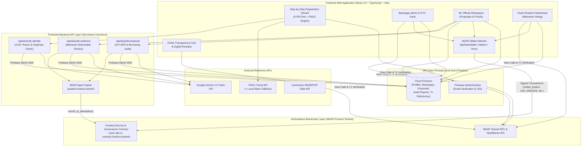
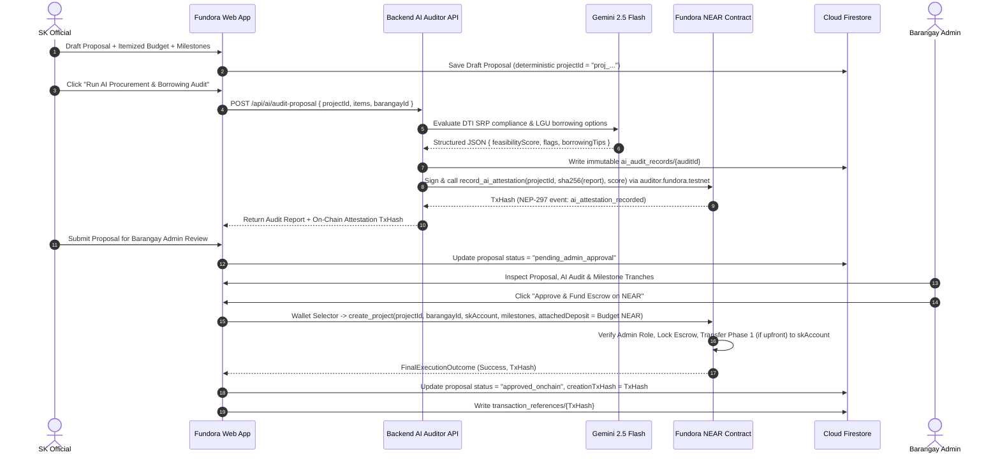
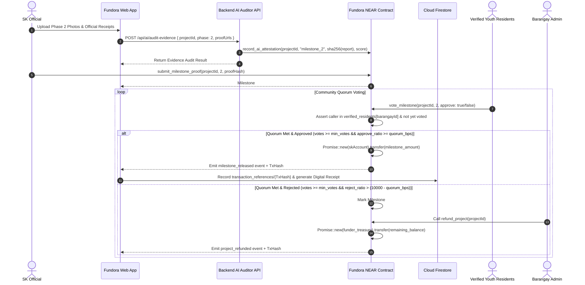

# Fundora — System Design Document (SDD)

**Document ID:** `FD-SDLC-04`  
**Version:** `1.0.0`  
**Date:** November 7, 2026  
**Product Name:** **Fundora**

---

## 1. High-Level Architecture Overview

Fundora employs a **Hybrid Civic-Fintech Architecture** that cleanly separates **cryptographic financial & governance finality** (on NEAR Protocol Testnet) from **rich civic document workflows, geographic onboarding, and AI advisory services** (on Firebase and Serverless Node/Vercel APIs).

---

## 2. Boundary of Authority: NEAR Smart Contract vs. Cloud Firestore

A foundational design rule in Fundora is that **Firestore is never an alternative authority for blockchain-controlled financial or voting state**.

| Domain Entity / State | Authoritative System | Supporting / Indexed System | Reconciliation & Verification Rule |
| :--- | :--- | :--- | :--- |
| **Escrow Treasury Balance (`yoctoNEAR`)** | **NEAR Smart Contract** (`Project.remaining_balance`) | Firestore (`project_metadata.cachedBalanceYocto`) | UI always reads live `get_project(project_id)` from NEAR RPC before rendering balances or action buttons. |
| **Project & Milestone Lifecycle Status** | **NEAR Smart Contract** (`ProjectStatus`, `MilestoneStatus`) | Firestore (`proposals.status`) | If Firestore `proposals.status` lags behind on-chain `ProjectStatus`, the UI displays a `"Reconciliation Required"` badge and syncs Firestore to match NEAR. |
| **Community Votes & Quorum Resolution** | **NEAR Smart Contract** (`Milestone.votes_approve`, `votes_reject`, `voters`) | Firestore (`transaction_references`) | Only votes recorded in the NEAR contract count toward quorum or payout release. |
| **On-Chain Role Eligibility (`BarangayAdmin`, `SKOfficial`, `VerifiedResident`)** | **NEAR Smart Contract** (`barangays`, `verified_residents`, `sk_officials`) | Firestore (`users.role`, `users.verificationStatus`) | Contract methods check on-chain LookupMaps (`unwrap_or(false)`). Approving a user in Firestore triggers an on-chain registration call. |
| **AI Audit Cryptographic Commitment** | **NEAR Smart Contract** (`AiAttestation.report_hash`, `score`) | Firestore (`ai_audit_records` full JSON text) | Anyone can hash the canonical JSON in `ai_audit_records` and verify it matches `report_hash` stored on NEAR by `auditor.fundora.testnet`. |
| **Proposal Prose, Itemized Budgets, Revision Diffs & KYC Documents** | **Cloud Firestore** (`proposals`, `users`, `verification_records`, `uploaded_documents`) | NEAR Smart Contract (`metadata_hash`) | Stored off-chain for cost efficiency and privacy (PII compliance), anchored on-chain via SHA-256 `metadata_hash`. |

---

## 3. Wallet Architecture & Access Key Security Analysis

### 3.1 Removal of Legacy Custodial Keys
The legacy `inAppWallet.service.ts` pattern (storing plaintext private keys in Firestore `users/{uid}.inAppWalletSecret`) is **completely eliminated**. Fundora never generates, transmits, or stores Full-Access private keys in Firestore or on any backend server for end users.

### 3.2 NEAR Wallet Selector Integration
Fundora integrates the official `@near-wallet-selector/core` and `@near-wallet-selector/modal-ui` packages, supporting:
- **MyNearWallet** (`@near-wallet-selector/my-near-wallet`) — Browser web wallet ideal for non-extension users on mobile and desktop.
- **Meteor Wallet** (`@near-wallet-selector/meteor-wallet`) — Popular NEAR browser extension and web wallet.
- **Here Wallet** (`@near-wallet-selector/here-wallet`) — Mobile-friendly NEAR wallet.

### 3.3 Honest Technical Analysis of Function-Call Access Keys
In NEAR Protocol, an account can have two types of keys: **Full-Access Keys** and **Function-Call Access Keys**. It is essential to document their exact protocol behavior honestly:

1. **What Function-Call Access Keys Actually Do:**
   - When a user signs in via NEAR Wallet Selector specifying `contractId: "contract.fundora.testnet"` and `methodNames: ["vote_milestone", "submit_milestone_proof"]`, the wallet generates a scoped `ed25519` keypair in the browser's `localStorage` and submits an `AddKey` transaction on-chain granting `FunctionCallPermission`:
     - `receiver_id`: `"contract.fundora.testnet"` (cannot call any other contract).
     - `method_names`: Restricted to non-payable governance methods (`vote_milestone`, `submit_milestone_proof`).
     - `allowance`: Default max `0.25 NEAR`strictly for gas fees.
   - **Critical Protocol Limitation 1 (Attached Deposits):** On NEAR Protocol, a Function-Call Access Key **cannot sign any transaction that attaches > 0 `yoctoNEAR` deposit** (`AttachedDeposit > 0`). Even `1 yoctoNEAR` requires a Full-Access Key signature via the wallet popup/redirect.
   - **Critical Protocol Limitation 2 (Gas Fees):** A Function-Call Access Key **does NOT make transactions "gasless"**. The gas consumed by the transaction is still deducted from the user's own NEAR account balance (up to the key's `allowance`). Truly gasless transactions for unfunded accounts require a **Meta-Transaction Relayer (NEP-366 `DelegateAction`)** where a backend relayer account pays the gas.

2. **How Fundora Uses Access Keys Safely:**
   - **Payable Financial Actions (`create_project` with attached NEAR escrow):** Always require an explicit **Full-Access Key** confirmation popup in the user's wallet so the Barangay Admin explicitly reviews and authorizes the exact NEAR escrow transfer amount.
   - **Non-Payable Governance Actions (`vote_milestone`, `submit_milestone_proof`):** Written in the smart contract to require **zero attached deposit (`0 yoctoNEAR`)** (using pre-allocated project storage from `create_project`), allowing users connected with a scoped Function-Call Access Key to cast milestone votes without a repetitive redirect popup while keeping their funds 100% protected.
   - **Key Lifecycle & Revocation:** Users can unlink or rotate their wallet in `ProfileSettingsPanel`, which clears the local session key and prompts `DeleteKey` if desired.

### 3.4 Account-to-Wallet Binding (`wallet_links/{uid}`)
When an authenticated user links a NEAR account (`alice.testnet`):
1. The user signs a challenge message (NEP-413 `signMessage`) or completes the Wallet Selector sign-in handshake.
2. Fundora verifies that no other active user in Firestore has already bound `alice.testnet` (preventing 1-wallet-many-resident Sybil voting).
3. Once verified, the Barangay Admin's approval registers `alice.testnet` on-chain in `contract.fundora.testnet` for the user's `barangayId`.

---

## 4. End-to-End Sequence Diagrams

### 4.1 Proposal Audit, Approval & Escrow Locking Flow

### 4.2 Milestone Proof, Community Quorum Voting & Payout / Refund Flow

---

## 5. Transaction Lifecycle & Reconciliation State Machine

Every blockchain interaction in Fundora transitions through five explicit, user-visible states:

1. **`Submitted`:** User has approved the transaction in NEAR Wallet Selector (or via scoped Function-Call key) and the signed payload has been broadcast to NEAR Testnet RPC.
2. **`Pending`:** Transaction is in-flight across NEAR chunks/receipts; UI shows a non-blocking progress banner with elapsed time.
3. **`Successful`:** NEAR RPC `FinalExecutionOutcome` returns `SuccessValue` (with all cross-contract/transfer receipts succeeding) **AND** the corresponding off-chain `transaction_references` and `proposals` metadata update in Firestore has succeeded.
4. **`Failed`:** NEAR RPC returns `Failure` (e.g., `ActionError`, assertion panic, or rejected wallet signature). No off-chain state is mutated, and a human-readable error explanation is shown.
5. **`Reconciliation Required`:** The on-chain NEAR transaction succeeded (`SuccessValue` with a valid `txHash`), **but** the subsequent client write to Firestore timed out or failed.
   - **Recovery Mechanism:** Before sending any on-chain transaction, Fundora writes a `pending_tx_intent` record to `localStorage` (and optionally Firestore). If the post-transaction Firestore update fails, the UI displays an amber `"Reconciliation Required — On-Chain Action Succeeded (Tx: 8f3a...)"` banner with a one-click `"Sync State"` button (and automatic background retry on page load) that queries `get_project(project_id)` from NEAR RPC and updates Firestore idempotently.

---

## 6. Transaction-Linked Digital Receipts Design

Fundora preserves the high-value civic receipt workflow (`ReceiptModal` and downloadable PDF via `jsPDF`) while ensuring **100% factual and legal accuracy**:

- **Terminology:** Labeled as **"Fundora Transaction-Linked Digital Receipt"** (replacing unverified statutory claims of R.A. 8792 / BIR / COA official accreditation).
- **Cryptographic & On-Chain Fields:**
  - `Receipt Reference ID`: Deterministic `FD-RCPT-{YYYYMMDD}-{TX_PREFIX}`
  - `NEAR Transaction Hash`: Full base58 hash (`e.g., 9xQeWvG816bUx9EPjHmaT23yvVM2ZWbrrpZb9PusVFin`)
  - `Signer Account` & `Recipient Account`: Human-readable `.testnet` NEAR accounts
  - `Barangay Jurisdiction`: Official Barangay Name + 10-digit `psgcCode`
  - `Amount`: Exact `NEAR` amount (`yoctoNEAR` converted to 4 decimal places) + snapshot `PHP` equivalent (`@ ₱X.XX / NEAR`)
  - `Document Integrity Hash`: SHA-256 hash of the canonical receipt payload
  - `Verification QR Code`: Encodes the direct **NearBlocks Testnet Explorer URL** (`https://testnet.nearblocks.io/txns/{txHash}`) so any resident, official, or auditor can scan the PDF with a phone camera and verify the transaction on the live NEAR blockchain.

---

## 7. Phase 4 Implementation & Verification Summary

- **NEAR Wallet Selector & Contract Service:**
  - [`src/contexts/NearWalletContext.tsx`](file:///C:/Users/Renz%20Jericho%20Buday/Fundora/src/contexts/NearWalletContext.tsx) — Non-custodial wallet connection (`MyNearWallet`, `Meteor Wallet`, `HERE Wallet`), account switching, 1-wallet-1-user Sybil uniqueness enforcement (`ERR_WALLET_ALREADY_BOUND`), network mismatch validation (`ERR_NETWORK_MISMATCH`), and scoped `0 yoctoNEAR` Function-Call Access Key session management (`submit_milestone_proof`, `vote_milestone`).
  - [`src/services/nearContract.service.ts`](file:///C:/Users/Renz%20Jericho%20Buday/Fundora/src/services/nearContract.service.ts) — Authoritative contract bindings for `create_project`, `submit_milestone_proof`, `vote_milestone`, `finalize_milestone_vote`, `refund_project`, `retry_failed_milestone_payout`, `register_verified_resident`, `set_sk_official`, and view methods (`get_project`, `get_projects_by_barangay`, `get_ai_attestations`, `is_verified_resident`), plus the 5-state transaction lifecycle (`SUBMITTED`, `PENDING`, `SUCCESSFUL`, `FAILED`, `RECONCILIATION_REQUIRED`) and `reconcileProjectState` recovery engine.
- **Core Role Workspaces:**
  - [`src/components/AdminPanel.tsx`](file:///C:/Users/Renz%20Jericho%20Buday/Fundora/src/components/AdminPanel.tsx) — Resident KYC approval & on-chain registration, selective resubmission presets, proposal review with explicit Full-Access wallet confirmation for `create_project`, and treasury-only `refund_project` routing.
  - [`src/components/SKWorkspace.tsx`](file:///C:/Users/Renz%20Jericho%20Buday/Fundora/src/components/SKWorkspace.tsx) — Deterministic `proj_<psgc>_<timestamp>` proposal authoring, 40/40/20 milestone tranche allocation, advisory AI procurement audit trigger, and `submit_milestone_proof` integration.
  - [`src/components/YouthDashboard.tsx`](file:///C:/Users/Renz%20Jericho%20Buday/Fundora/src/components/YouthDashboard.tsx) — Eligible Youth Resident (`15–30`) 1-resident-1-vote quorum voting (`vote_milestone`), read-only Over-30 `viewer` enforcement, and finality-verified tranche payout status display.
  - [`src/components/ActivityView.tsx`](file:///C:/Users/Renz%20Jericho%20Buday/Fundora/src/components/ActivityView.tsx) — Transaction reference ledger (`FD-RCPT-...`) and one-click `RECONCILIATION_REQUIRED` state synchronization.

