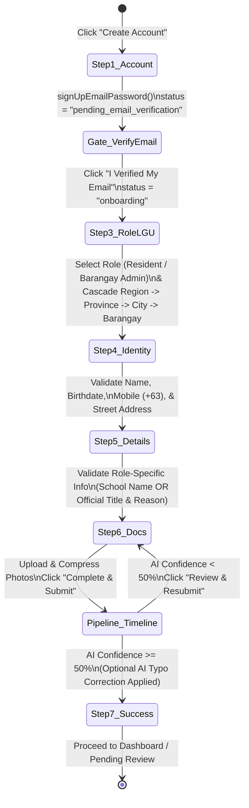

# Fundora — Registration Workflow, Geographic Resources & UI/UX Specification

**Document ID:** `FD-SDLC-08`  
**Version:** `1.0.0`  
**Date:** November 7, 2026  
**Product Name:** **Fundora**  
**Legacy Reference Files Inspected:**  
- [`src/views/auth/AuthPage.tsx`](file:///C:/Users/Renz%20Jericho%20Buday/barangay-bond/src/views/auth/AuthPage.tsx)  
- [`src/views/auth/LoginStep.tsx`](file:///C:/Users/Renz%20Jericho%20Buday/barangay-bond/src/views/auth/LoginStep.tsx)  
- [`src/views/auth/RoleLGUStep.tsx`](file:///C:/Users/Renz%20Jericho%20Buday/barangay-bond/src/views/auth/RoleLGUStep.tsx)  
- [`src/views/auth/DetailsStep.tsx`](file:///C:/Users/Renz%20Jericho%20Buday/barangay-bond/src/views/auth/DetailsStep.tsx)  
- [`src/views/auth/AddInfoStep.tsx`](file:///C:/Users/Renz%20Jericho%20Buday/barangay-bond/src/views/auth/AddInfoStep.tsx)  
- [`src/views/auth/UploadsStep.tsx`](file:///C:/Users/Renz%20Jericho%20Buday/barangay-bond/src/views/auth/UploadsStep.tsx)  
- [`src/views/auth/SuccessStep.tsx`](file:///C:/Users/Renz%20Jericho%20Buday/barangay-bond/src/views/auth/SuccessStep.tsx)  
- [`src/views/auth/VerifyEmailView.tsx`](file:///C:/Users/Renz%20Jericho%20Buday/barangay-bond/src/views/auth/VerifyEmailView.tsx)  
- [`src/components/VerificationTimeline.tsx`](file:///C:/Users/Renz%20Jericho%20Buday/barangay-bond/src/components/VerificationTimeline.tsx)  
- [`src/services/auth.service.ts`](file:///C:/Users/Renz%20Jericho%20Buday/barangay-bond/src/services/auth.service.ts)  
- [`src/repositories/barangay.repository.ts`](file:///C:/Users/Renz%20Jericho%20Buday/barangay-bond/src/repositories/barangay.repository.ts)  
- [`src/utils/reviewDecision.ts`](file:///C:/Users/Renz%20Jericho%20Buday/barangay-bond/src/utils/reviewDecision.ts)

---

## PART I — THE 9 FORMAL REGISTRATION PLANNING DELIVERABLES

Per Section 4 of the project directive, **Fundora preserves the complete guided step-by-step registration process** from `barangay-bond` while hardening its security, privacy, and NEAR integration boundaries.

---

### Deliverable 1: Registration Workflow Specification

The registration system uses internal wizard step states (`signUpStep` values `1, 3, 4, 5, 6, 7` plus the Email Verification Gate and AI Timeline overlay) mapped to a **5-Pill Visual Progress Bar** (`1. Account` $\rightarrow$ `2. Role / LGU` $\rightarrow$ `3. Identity` $\rightarrow$ `4. Details` $\rightarrow$ `5. Docs`):

#### Step-by-Step Progression Rules
1. **Step 1 — Account Credentials (`signUpStep === 1`, Pill `1. Account` — `LoginStep.tsx`):**
   - Collects `email` and `password` (with confirm/visibility toggle).
   - Creates Firebase Auth user, sends verification email (`sendEmailVerification`), and creates `users/{uid}` with `status: "pending_email_verification"`, `role: "resident"`, `barangayId: "unassigned"`.
2. **Email Activation Gate (`VerifyEmailView.tsx`):**
   - Intercepted by [`AppRoutes.tsx`](file:///C:/Users/Renz%20Jericho%20Buday/barangay-bond/src/routes/AppRoutes.tsx#L87-L95) whenever `status === "pending_email_verification"`.
   - Provides `"I Verified My Email"` (which reloads Firebase Auth token and transitions `status` to `"onboarding"`), `"Resend Verification Email"` (with 60-second cooldown), and `"Cancel & Sign Out"`.
3. **Step 3 — Role & LGU Jurisdiction (`signUpStep === 3`, Pill `2. Role / LGU` — `RoleLGUStep.tsx`):**
   - User selects `desiredRole`: **Youth Resident (`resident`)** or **Barangay Admin (`barangay_admin`)**.
   - **Resident Path:** Selects from active/approved barangays in Firestore using cascading dropdowns (`Region` $\rightarrow$ `Province` $\rightarrow$ `Municipality/City` $\rightarrow$ `Barangay Community`). If no approved barangay exists yet, displays a warning banner and disables the `Continue` button.
   - **Barangay Admin Path:** Selects from the full Philippine Standard Geographic Code (PSGC) hierarchy (`Region` $\rightarrow$ `Province` $\rightarrow$ `City/Municipality` $\rightarrow$ `Barangay` with `<datalist id="psgc-barangay-suggestions">`).
4. **Step 4 — Personal Identity & Street Address (`signUpStep === 4`, Pill `3. Identity` — `DetailsStep.tsx`):**
   - Collects `firstName`, `middleName` (optional), `lastName`, `suffix` (optional), `birthdate`, `mobileNumber`, and `address` (House # / Street / Purok).
   - Renders a read-only `"📍 Attached Jurisdiction: {Barangay}, {Municipality}, {Province}"` pill below the street address input so the user sees how their street address combines with their selected LGU.
5. **Step 5 — Role-Specific Context (`signUpStep === 5`, Pill `4. Details` — `AddInfoStep.tsx`):**
   - **If `resident`:** Collects optional `schoolName` (School / University Name, used when verifying a Student ID).
   - **If `barangay_admin`:** Requires `professionalInfo` (Official Barangay/SK Title) and `adminReason` (Appointment Justification).
6. **Step 6 — Identification & Document Uploads (`signUpStep === 6`, Pill `5. Docs` — `UploadsStep.tsx`):**
   - Collects `idType` (`barangay`, `student`, `national`, `passport`, `driver`, `other`), `idNumber`, `profilePhoto` (1x1/Avatar), `idPhoto` (Clear Government/Student ID), and—**only if `barangay_admin`**—`selfiePhoto` (Selfie holding ID card).
   - Client-side [`compressImage()`](file:///C:/Users/Renz%20Jericho%20Buday/barangay-bond/src/utils/imageCompressor.ts#L1-L38) resizes images to max `800x800` JPEG (`0.7` quality) before upload.
7. **Interactive AI Verification Pipeline (`VerificationLoadingTimeline` — `VerificationTimeline.tsx`):**
   - Displays 6 animated metric bars (`Government ID`, `Document Quality`, `Identity Match`, `Address Match`, `Duplicate Detection`, `Fraud Detection`) and 13 checklist stages (`Creating Fundora account...` through `Submitting application...`).
   - Renders **AI Typo Correction Suggested** cards whenever OCR-extracted `name`, `address`, or `idNumber` has a fuzzy similarity between $50\%\text{–}99\%$ with user inputs, letting the user apply corrections with one click.
8. **Step 7 — Completion Summary (`signUpStep === 7` — `SuccessStep.tsx`):**
   - Displays role-specific onboarding status and routes the user to their dashboard.

---

### Deliverable 2: Complete Registration User Journey (All Paths)

| User Persona | Step-by-Step Journey & System Outcome |
| :--- | :--- |
| **1. Youth Resident (Ages 15–30)** | Completes Step 1 $\rightarrow$ Verifies Email $\rightarrow$ Selects `Youth Resident` & active Barangay in Step 3 $\rightarrow$ Enters details (`15 <= age <= 30`) in Step 4 $\rightarrow$ Optional school in Step 5 $\rightarrow$ Uploads Profile + ID Photo in Step 6 $\rightarrow$ Passes AI Timeline ($\ge 50\%$) $\rightarrow$ Enters Barangay Admin's **Resident KYC Desk** (`status: "pending"`, `role: "resident"`). Once approved by Barangay Admin and linked to a NEAR wallet, registered in `verified_residents` on NEAR. |
| **2. Adult Citizen / Guest (Age > 30)** | Follows the Resident wizard steps, but upon submitting Step 6 with a `birthdate` where `age > 30`, the system enforces R.A. 10742 age rules ([`auth.service.ts`](file:///C:/Users/Renz%20Jericho%20Buday/barangay-bond/src/services/auth.service.ts#L206-L212)) and automatically provisions the account as `role: "viewer"`, `status: "active"`, `verificationStatus: "approved"`, granting immediate read-only access to the Public Transparency Hub without SK voting privileges. |
| **3. Underage Applicant (Age < 15)** | Blocked upon submission with explicit validation error: `"Age validation failed. Youth residents must be at least 15 years old under R.A. 10742."` |
| **4. Barangay Admin Applicant** | Selects `Barangay Admin` in Step 3 $\rightarrow$ Selects Region, Province, City/Municipality, and Barangay from PSGC hierarchy $\rightarrow$ Enters identity details in Step 4 $\rightarrow$ Enters Official Title & Appointment Reason in Step 5 $\rightarrow$ Uploads Profile Photo, Government ID, **and Selfie Holding ID** in Step 6 $\rightarrow$ Queued in `barangay_admin_requests` for `system_admin` (or existing Barangay Admin) approval. |
| **5. Resubmitting Applicant (`resubmission_required`)** | Logs in $\rightarrow$ Sees flagged notice banner with admin's specific reason $\rightarrow$ Clicks `"Update Flagged Info"` $\rightarrow$ `AuthPage` opens in Selective Resubmission Mode (`authEntryContext`), pre-filling all fields and skipping unflagged steps so the user only edits the requested fields (e.g., `photo_only` opens Step 6 directly). |

---

### Deliverable 3: Field and Validation Specification

| Wizard Step | Field Key | Input Type | Required? | Normalization & Validation Rule | Error Message |
| :--- | :--- | :--- | :--- | :--- | :--- |
| **Step 1 (`LoginStep`)** | `email` | `email` | **Yes** | [`normalizeEmail()`](file:///C:/Users/Renz%20Jericho%20Buday/barangay-bond/src/utils/normalization.ts#L53-L56): lowercase, trim whitespace, valid RFC email format. | `"Please enter a valid email address."` |
| **Step 1 (`LoginStep`)** | `password` | `password` | **Yes** | Minimum 8 characters (upgraded from legacy 6 chars) with at least 1 letter and 1 number. | `"Password must be at least 8 characters."` |
| **Step 3 (`RoleLGUStep`)** | `desiredRole` | Radio Card | **Yes** | Enum: `"resident"` \| `"barangay_admin"`. | `"Please select your account role."` |
| **Step 3 (`RoleLGUStep`)** | `selectedBarangayId` | Cascading `<select>` | **Yes** (Resident) | Must match an existing `barangays/{id}` where `status == "approved"` and `active == true`. | `"Please select your Barangay Community to continue."` |
| **Step 3 (`RoleLGUStep`)** | `adminReqRegion`, `Province`, `Municipality`, `BarangayName` | Cascading `<select>` + `<datalist>` | **Yes** (Admin) | Must select Region, Province (or NCR auto-province), City/Municipality, and non-empty Barangay name + resolved `psgcCode`. | `"Please complete the Region, Province, Municipality, and Barangay fields."` |
| **Step 4 (`DetailsStep`)** | `firstName`, `lastName` | `text` | **Yes** | [`normalizeName()`](file:///C:/Users/Renz%20Jericho%20Buday/barangay-bond/src/utils/normalization.ts#L1-L22): Title Case words, preserve initials (`J.P.`) and hyphens. Min 2 chars. | `"Please provide your first and last name."` |
| **Step 4 (`DetailsStep`)** | `middleName`, `suffix` | `text` | Optional | `normalizeName()` if provided. | N/A |
| **Step 4 (`DetailsStep`)** | `birthdate` | `date` | **Yes** | Valid past date; calculates exact age. If `desiredRole == "resident"` and `age < 15`, reject. | `"Residents must be at least 15 years old."` |
| **Step 4 (`DetailsStep`)** | `mobileNumber` | `tel` | **Yes** | [`normalizeMobileNumber()`](file:///C:/Users/Renz%20Jericho%20Buday/barangay-bond/src/utils/normalization.ts#L41-L51): converts `09XXXXXXXXX` or `9XXXXXXXXX` to `+639XXXXXXXXX` (13 chars). | `"Please enter a valid Philippine mobile number (+639XXXXXXXXX)."` |
| **Step 4 (`DetailsStep`)** | `address` (Street) | `text` | **Yes** | House/Unit #, Street, Sitio/Purok. Stripped of duplicate LGU suffixes via `extractStreetOnlyAddress()` on edit. | `"Please enter your house number and street address."` |
| **Step 5 (`AddInfoStep`)** | `schoolName` | `text` | Optional (Resident) | Trimmed string; recommended when `idType == "student"`. | N/A |
| **Step 5 (`AddInfoStep`)** | `professionalInfo`, `adminReason` | `text`, `textarea` | **Yes** (Admin) | Non-empty official title and appointment explanation (min 10 chars). | `"Please provide your official title and reason for appointment."` |
| **Step 6 (`UploadsStep`)** | `idType` | `<select>` | **Yes** | `"barangay"` \| `"student"` \| `"national"` \| `"passport"` \| `"driver"` \| `"other"`. | `"Please select an ID type."` |
| **Step 6 (`UploadsStep`)** | `idNumber` | `text` | **Yes** | Trimmed alphanumeric string matching the uploaded ID card. | `"Please enter your ID number."` |
| **Step 6 (`UploadsStep`)** | `profilePhoto`, `idPhoto` | `file` (`image/*`) | **Yes** (All) | Compressed via `compressImage(base64, 800, 800, 0.7)`. | `"Please upload your profile photo and a clear copy of your ID."` |
| **Step 6 (`UploadsStep`)** | `selfiePhoto` | `file` (`image/*`) | **Yes** (Admin) | Required for `barangay_admin`; skipped for `resident`. | `"Barangay Admins must upload a selfie holding their ID."` |

---

### Deliverable 4: Geographic Data & PSGC Architecture Specification

#### How Geographic Data Works in `barangay-bond` (Verified from Source)
In [`AuthPage.tsx`](file:///C:/Users/Renz%20Jericho%20Buday/barangay-bond/src/views/auth/AuthPage.tsx#L337-L407) and [`RoleLGUStep.tsx`](file:///C:/Users/Renz%20Jericho%20Buday/barangay-bond/src/views/auth/RoleLGUStep.tsx#L121-L361):
1. **External API Used:** The application fetches official Philippine Standard Geographic Code (PSGC) data dynamically from `https://psgc.cloud/api`:
   - Regions: `GET https://psgc.cloud/api/regions`
   - Provinces in Region: `GET https://psgc.cloud/api/regions/{regionCode}/provinces`
   - **NCR Special Handling ([`AuthPage.tsx`](file:///C:/Users/Renz%20Jericho%20Buday/barangay-bond/src/views/auth/AuthPage.tsx#L351-L366)):** Because the National Capital Region (NCR) has no provinces in PSGC, `/regions/{code}/provinces` returns an empty array `[]`. The code detects `data.length === 0`, synthesizes a virtual province `{ code: "NCR", name: "Metro Manila" }`, and fetches cities/municipalities directly from `GET https://psgc.cloud/api/regions/{regionCode}/cities-municipalities`.
   - Cities/Municipalities in Province: `GET https://psgc.cloud/api/provinces/{provinceCode}/cities-municipalities`
   - Barangays in City/Municipality: `GET https://psgc.cloud/api/cities-municipalities/{muniCode}/barangays`
2. **Resident Barangay Cascading ([`RoleLGUStep.tsx`](file:///C:/Users/Renz%20Jericho%20Buday/barangay-bond/src/views/auth/RoleLGUStep.tsx#L219-L360)):**
   - Queries `approvedBarangays` from Firestore (`barangays` collection where `status == "approved"` or `active == true`).
   - Extracts unique `region`, `province`, and `municipality` values from those approved documents (defaulting missing region labels to `"National Capital Region (NCR)"`) so residents only drill down into jurisdictions that have an active Barangay Treasury on the platform.

#### Enhancements in Fundora
- **Canonical 10-Digit `psgcCode` Capture:** In `barangay-bond`, `RoleLGUStep.tsx` (`L202`) used `<datalist>` matching by `b.name`, discarding `b.code`. In **Fundora**, when a Barangay Admin selects a barangay from the PSGC list, Fundora captures both `b.name` and the official 10-digit `b.code` (`psgcCode`, e.g., `"1376020030"` for Brgy. Bel-Air, Makati) and generates a deterministic `barangayId = "brgy_" + psgcCode`.
- **Offline / Timeout Resilience (`psgcFallback.json`):** If `https://psgc.cloud/api` times out ($> 3\text{s}$) or is unreachable during the hackathon demo, Fundora automatically falls back to a bundled static PSGC JSON dataset (`src/data/psgcFallback.json`) containing all 17 Philippine Regions, key Provinces/Cities (Metro Manila, Cebu, Davao, Laguna, Cavite, Iloilo, etc.), and sample barangays.

---

### Deliverable 5: Barangay Code Reuse and Migration Assessment

| Aspect | Legacy `barangay-bond` Implementation | Fundora Reuse & Upgrade Decision |
| :--- | :--- | :--- |
| **`Barangay` Domain Interface** | [`src/types/domain.types.ts`](file:///C:/Users/Renz%20Jericho%20Buday/barangay-bond/src/types/domain.types.ts#L10-L24) defines `id`, `name`, `municipality`, `province`, `region`, `psgcCode`, `zipCode`, `status`, `active`, `adminsCount`, `residentsCount`, `projectsCount`. | **REUSE 100% of fields** + add `onChainRegistered: boolean`, `isDemo: boolean`, `quorumBps: number`, `minVotes: number`. |
| **`barangayRepository`** | [`src/repositories/barangay.repository.ts`](file:///C:/Users/Renz%20Jericho%20Buday/barangay-bond/src/repositories/barangay.repository.ts#L1-L71) provides `getBarangay`, `createBarangay`, `updateBarangay`, `proposeBarangay`, `getApprovedBarangays`. | **REUSE directly**, updating `proposeBarangay` to persist `psgcCode` and `region` and generating deterministic IDs (`brgy_{psgcCode}`). |
| **PSGC Cascading Logic & NCR Fallback** | Embedded inside [`AuthPage.tsx`](file:///C:/Users/Renz%20Jericho%20Buday/barangay-bond/src/views/auth/AuthPage.tsx#L337-L407). | **EXTRACT & REUSE** into a dedicated hook `usePsgcGeographicSelector.ts` with automatic static JSON fallback. |
| **On-Chain Jurisdiction Binding** | Legacy contract had **no** barangay awareness (`lib.rs` had a single global admin). | **NEW IN FUNDORA:** `barangayId` (`brgy_{psgcCode}`) is registered directly in the NEAR smart contract (`register_barangay(barangay_id, psgc_code, ...)`), ensuring 1:1 parity between Firestore and NEAR. |

---

### Deliverable 6: Registration Data Model Separation

To enforce least-privilege privacy and clean multi-stage state transitions, Fundora separates registration data into five distinct logical layers:
1. **Authentication Account (`Firebase Auth` + `users/{uid}`):** `uid`, `email`, `emailVerified`, `status` (`pending_email_verification` $\rightarrow$ `onboarding` $\rightarrow$ `pending` $\rightarrow$ `active`).
2. **Barangay Affiliation (`users/{uid}` + `barangays/{barangayId}`):** `barangayId`, `psgcCode`, `barangayName`, `municipality`, `province`, `region`.
3. **Personal & Documentary Identity (`registration_records/{uid}` + `uploaded_documents/{uid}_*`):** `birthdate`, `mobileNumber`, `streetAddress`, `idType`, `idNumberHash`, `idNumberRaw`, compressed Base64 images.
4. **Verification & Role Eligibility (`verification_records/{uid}` + `users/{uid}`):** `aiConfidence`, `scores`, `duplicateRisk`, `reviewOutcome`, `resubmissionPreset`, `resubmissionFields`, `role`, `position`, `termEnd`.
5. **Non-Custodial Wallet Binding (`wallet_links/{uid}` + NEAR `verified_residents` / `sk_officials`):** `nearAccountId`, `walletProvider`, `linkedAt`, `onChainRoleSynced`. Wallet linking is **decoupled from initial registration** so non-technical citizens can register and pass KYC first, and link their NEAR wallet when ready to vote or manage escrows.

---

### Deliverable 7: Identity and Eligibility Verification Design

1. **Automated Pre-Screening (Backend `/api/ai/verify-identity`):**
   - Verifies image readability, compares OCR-extracted `name`, `idNumber`, and `address` against form inputs, checks `idNumberHash` and fuzzy `name + birthdate` against existing `registration_records` in the same barangay, and computes an overall score ($0\text{–}100$).
   - **Score $< 50$:** Immediately rejected during the `VerificationLoadingTimeline` with a clear prompt to upload a clearer ID photo (`Review & Resubmit`).
   - **Score $50\text{–}89$:** Flagged as `"Manual Review Required"` and placed in the Barangay Admin's KYC queue.
   - **Score $\ge 90$ (with `Low` duplicate risk):** Marked `"AI Pre-Verified / Low Risk"` in the Barangay Admin's KYC queue for 1-click approval and on-chain NEAR registration.
2. **Human Admin Decision Outcomes ([`reviewDecision.ts`](file:///C:/Users/Renz%20Jericho%20Buday/barangay-bond/src/utils/reviewDecision.ts)):**
   - **Approve:** Sets `verificationStatus: "approved"`, `status: "active"`, `verified: true`, and triggers `register_verified_resident` on the NEAR smart contract if `nearAccountId` is linked.
   - **Request Selective Resubmission:** Admin chooses a preset (`photo_only`, `details_only`, `full_package`, `custom`) and specific `resubmissionFields` (`idPhotoUrl`, `selfiePhotoUrl`, `profilePhotoUrl`, `idNumber`, `name`, `address`, `barangayProof`). User receives an in-app notification and edits only the flagged fields.
   - **Reject:** Sets `verificationStatus: "rejected"`, `status: "inactive"`.

---

### Deliverable 8: Registration Security and Privacy Assessment

- **Elimination of Client-Side Collection Scanning:** In `barangay-bond`, `checkDuplicates()` ([`verification.service.ts`](file:///C:/Users/Renz%20Jericho%20Buday/barangay-bond/src/services/verification.service.ts#L50-L110)) downloaded the entire `users` collection to the browser to compare names and ID numbers. In **Fundora**, duplicate detection runs strictly on the backend using `idNumberHash` and scoped server queries.
- **Image Compression & Storage Minimization:** [`compressImage()`](file:///C:/Users/Renz%20Jericho%20Buday/barangay-bond/src/utils/imageCompressor.ts) caps uploaded images at `800x800` JPEG (`~60–120 KB`), preventing Firestore `1 MB` document bloat and minimizing PII transfer payloads.
- **Zero On-Chain PII:** Only the user's NEAR `AccountId` (e.g., `resident1.testnet`) and `barangay_id` (`brgy_1376020030`) are stored on the public NEAR blockchain—**never** real names, birthdates, addresses, or ID numbers.

---

### Deliverable 9: Registration Testing and Acceptance Criteria

| Test ID | Test Case | Expected Result |
| :--- | :--- | :--- |
| `REG-AC-01` | Step-by-step progression from Step 1 (`Account`) through Step 7 (`Success`) | All 5 progress pills update accurately; user cannot advance with blank required fields. |
| `REG-AC-02` | Email verification gate enforcement | Refreshing the page while `status == "pending_email_verification"` keeps user locked in `VerifyEmailView`. |
| `REG-AC-03` | NCR PSGC cascading for Barangay Admin | Selecting `"National Capital Region (NCR)"` auto-populates `"Metro Manila"` province and loads all 17 NCR cities/municipalities and their barangays. |
| `REG-AC-04` | Age bracket routing (`<15`, `15–30`, `>30`) | Age 14 throws validation error; Age 21 registers as `resident`; Age 35 auto-provisions as active `viewer`. |
| `REG-AC-05` | Selective resubmission (`photo_only` vs. `details_only`) | User flagged with `photo_only` skips Steps 3–5 and lands directly on Step 6 (`UploadsStep`) with only photo fields required. |

---

## PART II — FUNDORA UI/UX & DESIGN SYSTEM SPECIFICATION

### 1. Brand Identity & Dual-Theme Design Tokens
Fundora retains and refines the high-craft **Dual-Theme Civic Neobank Design System** from [`src/index.css`](file:///C:/Users/Renz%20Jericho%20Buday/barangay-bond/src/index.css#L1-L235), rebranded with **Fundora** visual identity:
- **Typography:**
  - Headings & UI: `'Plus Jakarta Sans', 'Inter', -apple-system, sans-serif` (`--font-main`)
  - Hashes, NEAR Accounts & Amounts: `'JetBrains Mono', monospace` (`--font-mono`)
- **Dark Theme (Default `[data-theme="dark"]`):**
  - `--bg-base: #070a12`, `--bg-surface: #0f1422`, `--bg-elevated: #161e32`
- **Light Theme (`[data-theme="light"]`):**
  - `--bg-base: #f1f5f9`, `--bg-surface: #ffffff`, `--bg-elevated: #f8fafc`
- **Role-Dynamic Accent Palettes:**
  - **Youth Resident (`.role-resident`):** Emerald Neobank (`#00d665`)
  - **SK Official (`.role-sk_official`):** Electric Indigo (`#6366f1`)
  - **Barangay Admin (`.role-barangay_admin`):** Royal Sapphire (`#007dfe`)
  - **System Admin (`.role-system_admin`):** Velvet Crimson (`#f43f5e`)
  - **Public Auditor / Viewer (`.role-viewer`):** Cyan Transparency (`#06b6d4`)

### 2. Core Navigation & Responsive Layout
- **Desktop (`>= 1024px`):** Left collapsible glassmorphic sidebar (`MainLayout`) + top contextual header displaying active Barangay badge (`📍 Brgy. Bel-Air • PSGC 1376020030`), live `NEAR / PHP` rate ticker, NEAR Wallet Selector status pill, and Theme Toggle.
- **Mobile (`< 768px`):** Sticky top app bar + floating bottom navigation dock (`--bg-dock`) with touch-friendly `48px` tap targets and bottom-sheet modals.
- **Isolated Judge Demo Switcher:** A floating, collapsible `"⚡ Hackathon Judge Demo Mode"` toolbar visible only when viewing the isolated `Brgy. San Antonio (Demo)` jurisdiction (`brgy_demo_001`), allowing 1-click switching between pre-seeded Demo Barangay Admin, Demo SK Chairperson, Demo Youth Resident, and Public Auditor personas.

