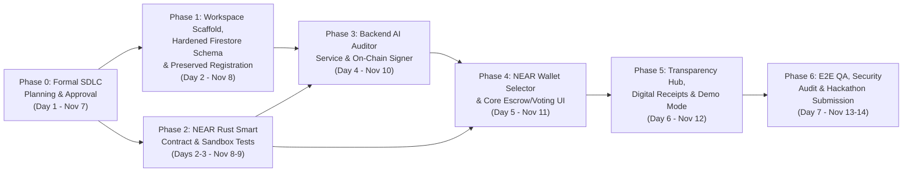

# Fundora — Phased Implementation Roadmap

**Document ID:** `FD-SDLC-11`  
**Version:** `1.0.0`  
**Date:** November 7, 2026  
**Hackathon Window:** November 7, 2026 – November 14, 2026 (7-Day Sprint)  
**Target Workspace:** `C:\Users\Renz Jericho Buday\Fundora`

---

## 1. Scope Tier Classification

To guarantee a stable, end-to-end verifiable submission before the **November 14, 2026** deadline, all features are categorized into four strict tiers:

| Tier | Included Capabilities |
| :--- | :--- |
| **1. Core Hackathon MVP (Must-Have — Days 1–6)** | • Clean-room React + TypeScript + Vite scaffold in `Fundora` with Fundora branding & dual-theme CSS tokens • Authoritative **NEAR Rust Smart Contract (`near-sdk-rs`)** deployed to NEAR Testnet (`contract.fundora.testnet`) with multi-barangay isolation, RBAC, deterministic `project_id`, native NEAR escrow, configurable quorum, AI attestation recording, and treasury refund on rejection • **NEAR Wallet Selector** integration (MyNearWallet, Meteor, Here Wallet) + Function-Call Access Key session support for voting • **Preserved 5-Pill Step-by-Step Registration Wizard** with PSGC geographic cascading (including NCR handling & static fallback), age-bracket routing (`15–30` Resident, `>30` Viewer), and Selective Resubmission Mode • **Protected Backend AI & Verification API** (`/api/ai/verify-identity`, `/api/ai/audit-proposal`, `/api/ai/audit-evidence`) with DTI SRP & inter-agency borrowing checks + on-chain attestation signing via `auditor.fundora.testnet` • Core Role Workspaces (`AdminPanel`, `SKWorkspace`, `YouthDashboard`, `TransparencyHub`, `ActivityView`) • **Transaction-Linked Digital Receipts** (Interactive Modal + `jsPDF` download with NearBlocks Testnet QR code) • Hardened `firestore.rules` (zero secret keys, PII separation, single match blocks) |
| **2. Post-MVP Polish (Day 6–7)** | • **Isolated Judge Demo Mode** (`Brgy. San Antonio (Demo)`, `brgy_demo_001`) with 1-click role-switcher toolbar and pre-seeded NEAR Testnet projects • Two-way Proposal Revision & Side-by-Side Diff Viewer (`ProposalRevisionModal`, `ProposalDiffModal`) • Automated `Reconciliation Required` recovery banner for interrupted post-tx Firestore writes |
| **3. Stretch Goals (Only if Days 1–6 complete ahead of schedule)** | • NEP-366 Meta-Transaction Relayer for zero-gas resident voting on brand-new accounts • Real-time NearBlocks webhook / indexer sync service |
| **4. Explicitly Deferred (Post-Hackathon)** | • NEP-141 Stablecoin (`USDC.e` / `USDT`) cross-contract escrow (`ft_transfer_call` + `NEP-145` storage management) • Cross-chain NEAR Intents & Chain Signatures • Native iOS / Android mobile wrapper |

---

## 2. Dependency Flow Diagram

---

## 3. Detailed Execution Phases (Post-Approval)

### Phase 1: Workspace Foundation, Hardened Data Layer & Preserved Registration (Nov 8, 2026)
- **Objectives:** Initialize the `C:\Users\Renz Jericho Buday\Fundora` React 19 + TypeScript + Vite project, port and rebrand the dual-theme CSS design system, implement the hardened Firestore repositories (`users`, `registration_records`, `verification_records`, `barangays`, `proposals`, `ai_audit_records`, `transaction_references`), and port the complete 5-pill step-by-step registration wizard with PSGC cascading and static fallback.
- **Dependencies:** User approval of Phase 0 SDLC Documentation Package.
- **Deliverables:**
  - `package.json`, `vite.config.ts`, `tsconfig.json`, `firestore.rules`
  - `src/index.css` (Fundora Dual-Theme Civic Neobank Design System)
  - `src/hooks/usePsgcGeographicSelector.ts` + `src/data/psgcFallback.json`
  - `src/views/auth/*` (`AuthPage`, `LoginStep`, `RoleLGUStep`, `DetailsStep`, `AddInfoStep`, `UploadsStep`, `VerifyEmailView`, `SuccessStep`, `VerificationTimeline`)
- **Acceptance Criteria & Testing:** All 5 registration pills progress cleanly; NCR PSGC fallback works online and offline; `<15`, `15–30`, and `>30` age brackets route accurately; Firestore emulator rules tests pass.
- **Completion Condition:** User can register as Resident, Viewer, or Barangay Admin in `Fundora` with zero references to `Barangay Bond` or `inAppWalletSecret`.

### Phase 2: NEAR Rust Smart Contract (`near-sdk-rs`) & Sandbox Verification (Nov 8–9, 2026)
- **Objectives:** Implement, compile, and test the authoritative `fundora-escrow` smart contract in Rust (`near-sdk = "5.6.0"`) and deploy it to NEAR Testnet.
- **Dependencies:** `FD-SDLC-05` Smart Contract Specification.
- **Deliverables:**
  - `contracts/fundora-escrow/Cargo.toml` & `src/lib.rs`
  - Unit test suite (`#[cfg(test)]`) & `near-workspaces` integration tests
  - Deployed contract on NEAR Testnet + initialized `system_admin`, `ai_auditor` (`auditor.fundora.testnet`), and isolated demo jurisdiction (`brgy_demo_001`)
- **Acceptance Criteria & Testing:** 100% pass rate across `SC-TEST-01` through `SC-TEST-07` (strict voter eligibility, configurable quorum, upfront Phase 1 mobilization, subsequent milestone release, and refund strictly back to `funder_treasury`).
- **Completion Condition:** Contract WASM deployed to NEAR Testnet and verified via `near-cli-rs` view/call smoke tests.

### Phase 3: Server-Side AI Auditor & Verification API + On-Chain Attestation Signer (Nov 10, 2026)
- **Objectives:** Build the serverless backend API endpoints (`/api/ai/verify-identity`, `/api/ai/audit-proposal`, `/api/ai/audit-evidence`) powered by Gemini 2.5 Flash and `near-api-js` (`auditor.fundora.testnet`).
- **Dependencies:** Phase 1 repositories & Phase 2 deployed NEAR contract.
- **Deliverables:**
  - `api/ai/verify-identity.ts` (OCR rubric + privacy-preserving server-side duplicate check)
  - `api/ai/audit-proposal.ts` (DTI SRP benchmarking + inter-agency borrowing recommendations + `record_ai_attestation` tx)
  - `api/ai/audit-evidence.ts` (Multimodal deliverable review + `record_ai_attestation` tx)
- **Acceptance Criteria & Testing:** Zero `VITE_GEMINI_API_KEY` in client bundle; valid JSON schema outputs; deterministic fallback when Gemini is unreachable; verifiable `ai_attestation_recorded` events on NearBlocks Testnet.
- **Completion Condition:** Triggering a proposal audit returns structured DTI/borrowing findings and a live NEAR Testnet attestation `txHash`.

### Phase 4: NEAR Wallet Selector & Core Role Workspaces (`AdminPanel`, `SKWorkspace`, `YouthDashboard`) (Nov 11, 2026)
- **Objectives:** Integrate `@near-wallet-selector/*`, build the NEAR RPC client and transaction lifecycle manager (`Submitted`, `Pending`, `Successful`, `Failed`, `Reconciliation Required`), and connect the Admin, SK Official, and Youth Resident workspaces to the NEAR contract.
- **Dependencies:** Phases 1, 2, and 3.
- **Deliverables:**
  - `src/contexts/NearWalletContext.tsx` & `src/services/nearContract.service.ts`
  - `src/components/AdminPanel.tsx` (Resident KYC Desk, SK Council Management, Proposal Escrow Funding, Rejected Escrow Treasury Refund)
  - `src/components/SKWorkspace.tsx` (Proposal Authoring, AI Audit Trigger, Revision Diffs, Milestone Proof Upload)
  - `src/components/YouthDashboard.tsx` (Milestone Evidence Inspection, AI Summary View, 1-Resident-1-Vote Quorum Voting)
- **Acceptance Criteria & Testing:** End-to-end escrow creation, Phase 1 mobilization, Phase 2 proof upload, community quorum voting, automatic payout release, and rejected project treasury refund all succeed on NEAR Testnet.
- **Completion Condition:** All 3 core role workspaces operate against live NEAR Testnet state and Firestore metadata.

### Phase 5: Public Transparency Hub, Transaction-Linked Receipts & Isolated Judge Demo Mode (Nov 12, 2026)
- **Objectives:** Complete the public accountability surfaces, QR verification modal, downloadable PDF digital receipts, and the isolated Judge Demo Mode switcher.
- **Dependencies:** Phase 4.
- **Deliverables:**
  - `src/components/TransparencyHub.tsx` & `src/components/ActivityView.tsx`
  - `src/components/ReceiptModal.tsx` & `src/utils/receiptPdfGenerator.ts` (with NearBlocks Testnet QR links and honest cryptographic verification terminology)
  - `src/components/QrModal.tsx`
  - `src/components/JudgeDemoToolbar.tsx` (scoped strictly to `brgy_demo_001`)
- **Acceptance Criteria & Testing:** Public users can inspect all project stages without connecting a wallet; generated PDF receipts contain real NEAR transaction hashes and working NearBlocks QR codes; Judge Demo Mode switches personas cleanly.
- **Completion Condition:** Complete feature parity with MVP + Polish requirements.

### Phase 6: End-to-End QA, Security Verification & Hackathon Submission Package (Nov 13–14, 2026)
- **Objectives:** Execute the full `FD-SDLC-09` test matrix, verify zero legacy branding or secret leaks, deploy production build, and finalize hackathon submission materials.
- **Dependencies:** Phases 1–5.
- **Deliverables:**
  - Passing test reports (Rust `cargo test`, Firestore Rules tests, Vitest unit tests, E2E verification)
  - Production deployment on Vercel connected to NEAR Testnet & Firebase
  - Comprehensive `README.md` and judge walkthrough guide in `C:\Users\Renz Jericho Buday\Fundora`
- **Completion Condition:** All acceptance criteria met prior to November 14, 2026 deadline.

---

## 4. Phase Execution Tracking & Verification Log

| Phase | Status | Commit Message | Verification & Test Results |
| :--- | :--- | :--- | :--- |
| **Phase 0 — SDLC Planning Package** | **COMPLETED** (`a24c92d`) | `docs: complete Fundora SDLC planning package` | All 12 formal SDLC documents authored and cross-checked (`FD-SDLC-01` through `FD-SDLC-12`). |
| **Phase 1 — Workspace Foundation, Hardened Data Layer & Registration** | **COMPLETED** | `feat(phase-1): establish Fundora foundation and registration` | `vitest run` (`11/11` tests passing across `registrationAndPsgc.test.tsx` and `firestoreRulesAndSecurity.test.ts`); `npm run build` (`tsc -b && vite build`) exit code `0`. |
| **Phase 2 — NEAR Rust Smart Contract (`near-sdk-rs`)** | **PENDING USER REVIEW OF PHASE 1** | `feat(phase-2): implement and test NEAR escrow contract` | Scheduled next upon Phase 1 approval. |
| **Phase 3 — Server-Side AI Auditor APIs** | **PENDING** | `feat(phase-3): implement protected AI auditor APIs` | Scheduled after Phase 2. |
| **Phase 4 — NEAR Wallet Selector & Core Role Workspaces** | **PENDING** | `feat(phase-4): integrate NEAR wallet and core workspaces` | Scheduled after Phase 3. |
| **Phase 5 — Public Transparency Hub, Receipts & Judge Demo** | **PENDING** | `feat(phase-5): implement transparency and judge demo features` | Scheduled after Phase 4. |
| **Phase 6 — End-to-End QA & Release Verification** | **PENDING** | `release(phase-6): complete Fundora MVP verification` | Scheduled after Phase 5. |

